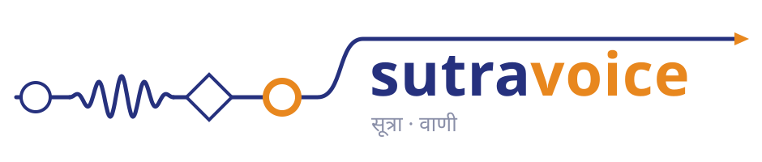

<p align="center">
  <picture>
    <source media="(prefers-color-scheme: dark)" srcset="assets/brand/sutra-voice-lockup-dark.svg">
    
  </picture>
</p>

Phone calls, IVRs and meetings for the [Sutra](https://github.com/startr-trade/sutra) workflow
engine. A BPMN flow answers a number, hears the caller one utterance at a time, speaks back,
transfers, hangs up, places calls of its own, or sits in on a conference or a video meeting —
recording, transcribing and analysing it through the engine's `llm` channels.

sutra-voice is open source under **MIT OR Apache-2.0**, like the engine. It does not fork the
engine: it consumes it as a git submodule and adds a transport through the engine's transport
SPI, plus its own engine image with that transport linked in.

Voice, meeting and video support is a **preview** in 0.6.0.

## What is here

| Path | What it is |
|---|---|
| `rust/crates/sutra-transport-voip` | The `voip` transport: a media WebSocket on the engine's HTTP listener, energy-VAD turns, real-time paced playback with barge-in, number binding, listen-only calls (recorded to an object store, sealed, transcribed live), meeting sessions (one tagged socket per meeting, per-participant audio and frames), segment analysis, and the rustpbx call-control client. |
| `rust/crates/sutra-voice-dist` | The composition root: the engine's default bundle plus `voip`, producing the `sutra-voice-engine` binary and image. |
| `rust/crates/sutra-voice-conformance` | The end-to-end suites (tier 2, Docker) and the example lint (tier 1). |
| `tools/sutra-webrtc-worker` | The WebRTC media worker — its own Cargo workspace and image, so nothing else links libwebrtc. Joins a LiveKit room and streams every participant to the engine. |
| `examples/voice-assistant` | An agentic responder on a number, post-call analytics, appointment-reminder calls on a capacity pool. rustpbx + SIPp. |
| `examples/ivr-dtmf` | A DTMF phone menu with recorded prompts, a DMN menu table, PIN entry and transfers. No model. |
| `examples/meeting-assistant` | Joins a conference by its SIP dial-in, records and transcribes it, writes the minutes. |
| `examples/video-meeting-assistant` | The same for a LiveKit video meeting, through the WebRTC worker, with per-participant segment analysis. |
| `examples/model-stub` | The stub model server the examples and tests use — no key, no network. |
| `docs/` | The mdBook, published at [voice.sutra.startr.trade](https://voice.sutra.startr.trade): introduction, quick start, architecture, guides ([the `voip` transport](docs/src/guides/voip-transport.md), [the WebRTC worker](docs/src/guides/webrtc-worker.md)), operations and roadmap. `mdbook build docs -d /tmp/sutra-voice-book` builds it; `scripts/docs-pele.sh --check` verifies the pinned diagram renderer. |
| `engine/` | The engine, as a git submodule (the public Sutra repository). |

Everything about BPMN itself — elements, wait states, channels, `llm` channels, packaging — is
the engine's, documented in the [Sutra book](https://sutra.startr.trade/). Start with
[channels and transports](https://sutra.startr.trade/building/channels.html) and
[calling a language model](https://sutra.startr.trade/building/llm-channels.html).

## Build

```bash
git clone --recurse-submodules https://github.com/startr-trade/sutra-voice
cd sutra-voice
make submodule        # if you cloned without --recurse-submodules
make build            # the workspace; engine crates come in as path dependencies
make image            # sutra-voice-engine:dev (fast release-it profile)
make worker-image     # sutra-webrtc-worker:dev (in Docker; first build fetches libwebrtc)
```

The image runs exactly like the engine's (`SUTRA_DEPLOYMENTS_DIR`, `SUTRA_HTTP_PORT`,
`SUTRA_DATASOURCE_*`), plus the transport's `SUTRA_VOIP_*` settings described in
[the voip transport guide](docs/src/guides/voip-transport.md). Package an example with the engine's `sutra`
CLI ([installation](https://sutra.startr.trade/getting-started/installation.html)); each example's
README has the exact commands and a local compose stack.

## Test

| Tier | Command | Needs |
|---|---|---|
| 1 | `make test` | the Rust toolchain |
| 2 | `make image && make test-docker` | Docker |
| worker | `make worker-lint worker-test` | Docker |

`make lint` (clippy `-D warnings`), `make fmt-check`, `make audit` (cargo-audit + cargo-deny) and
`make scan-deps` / `make scan-image` / `make worker-scan` (Trivy) are the other gates; CI runs
fmt, lint, tier 1, audit (of both workspaces) and the book. Tier 2 and the worker's lint and tests
run nightly; Trivy and CodeQL run on every push.

## The engine pin

`engine/` pins one exact engine commit (`git submodule status`). An engine change reaches this
repository only when the pin moves — a commit here that changes the submodule SHA. Never edit
files under `engine/` from this repository; make the change in the engine and move the pin.

> The initial pin is an engine commit that is not yet on GitHub. Until it is pushed to
> `github.com/startr-trade/sutra`, a fresh `git submodule update` cannot fetch it; a clone made
> next to a local engine checkout can fetch it from there
> (`git -C engine fetch <path-to-engine-checkout>`).

## Releases

A release is a `v*` tag; `.github/workflows/release.yml` does the rest and nothing else publishes.
It ships two images, each multi-arch (linux/amd64 + linux/arm64, built natively), cosign-signed
(keyless), with SLSA provenance and an SPDX SBOM attested to the digest and attached to the GitHub
Release:

| Image | What it is |
|---|---|
| `ghcr.io/startr-trade/sutra-voice` | the voice engine (`sutra-voice-engine`) |
| `ghcr.io/startr-trade/sutra-webrtc-worker` | the WebRTC media worker and `sutra-webrtc-participant` |

No CLI and no crates are published. The release body is `.github/releases/v<version>.md`.
Before anything is built, the tag must pass four gates; each is a script you can run locally:

1. **CI passed on the tagged commit** — `scripts/release-ci-gate.sh` asks GitHub for `ci.yml`'s
   run on that commit (waiting while it runs).
2. **The tag names the version** of both workspaces — `scripts/release-version-gate.sh v0.6.0`
   (`rust/Cargo.toml` and `tools/sutra-webrtc-worker/Cargo.toml`).
3. **`engine/` pins a released engine** — `scripts/release-engine-pin-gate.sh v0.6.0`: the pinned
   commit must be exactly a `v*` tag of `github.com/startr-trade/sutra`, a final one for a final
   release, with the same `MAJOR.MINOR`. Versions are aligned by minor with their own patch:
   sutra-voice 0.6.x runs on engine 0.6.x.
4. **Each image is clean under Trivy** before it is tagged — every severity, suppressions only
   through `.trivyignore.yaml` (`make scan-image`, `make worker-scan` locally).

So the order is: the engine tag exists → the pin names it → CI is green on the commit → tag it.

## License

Dual-licensed under either of [Apache License, Version 2.0](LICENSE-APACHE) or
[MIT license](LICENSE-MIT), at your option. The engine submodule carries its own (identical)
licence terms.
