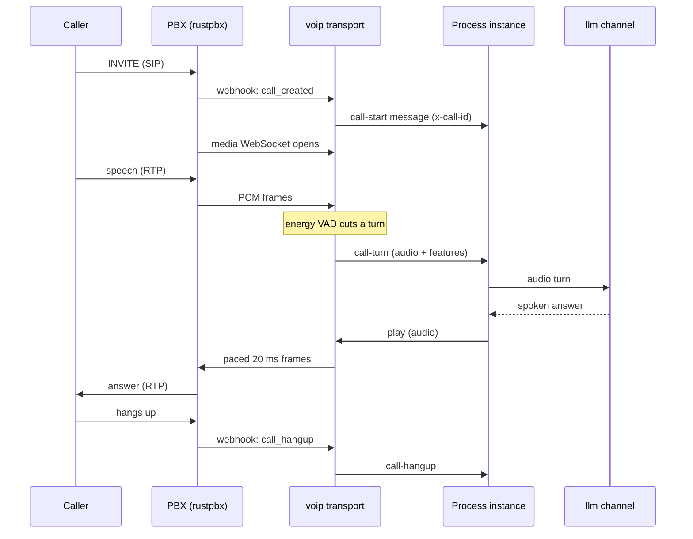

# Calls and the media protocol

## An inbound call

The call is one process instance. After each answer it returns to the same wait, an event-based
gateway on `call-turn`, `call-dtmf`, `call-hangup` and an idle timer, so the whole conversation is
a loop in the model. The transport delivers a call's messages strictly in order and holds the next
until the instance is ready for it.

## Why playback is paced

Audio goes to the gateway in real time, 20 ms per frame, never pre-buffered. When the caller starts
speaking while an answer is playing, the transport stops sending: that is **barge-in**, and it only
works because there is nothing already queued in the PBX that could not be taken back.

## An outbound call

A flow places a call with an `voip://originate` operation on an outbound channel. The transport
asks the gateway to originate through the configured trunk, waits for the outcome and reports it
on `call-progress`; once answered, the call is handed to the engine's media bridge and from then on
looks like any other call. With a capacity pool an originate waits in the outbox until a line is
free.

The full channel and operation reference is in [The voip transport](../guides/voip-transport.md).
