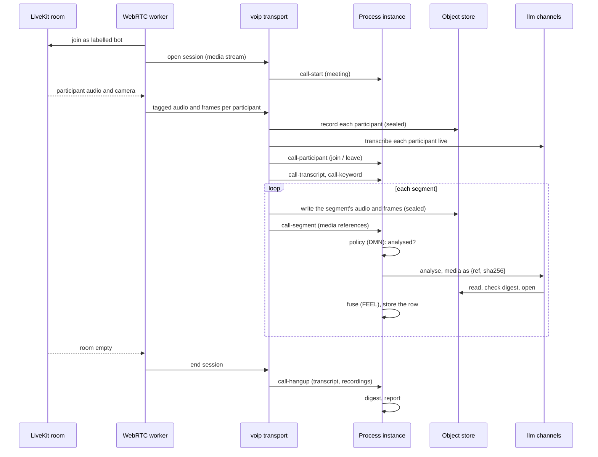

# Meetings and the WebRTC worker

## Two ways into a meeting

- **A conference dial-in.** The flow originates a call to the conference number, sends the meeting
  PIN as DTMF, announces recording, and from then on listens (a *listen-only* call). The meeting
  arrives as one mixed stream from the PBX.
- **A video meeting.** The WebRTC worker joins a LiveKit room as a participant and streams each
  participant separately, audio and sampled frames, over one tagged socket per meeting.

## The meeting session flow

Only sparse events and references reach the flow, never media: a participant joining, a phrase
being heard, a segment's references, the end of the meeting. The transport handles media and
generic measurements only; everything that interprets them is in the flow.

## Where the analysis lives

| Concern | Where |
|---|---|
| Cutting each participant's media into segments, writing them sealed, generic acoustic features | the transport (`call-segment`) |
| Who is analysed, and why not | the flow: a decision table (`rules/analysis-policy.dmn`) |
| The prompt, the model and its fallback | the flow (FEEL) and an `llm` channel with a `media-store` |
| Which signals support an emotion, what to keep of the answer, disagreement | the flow (FEEL) |
| The per-participant digest and the report | the flow (FEEL, a template) |

So a prompt or a policy changes with a package version, not an engine upgrade, and every decision
is a step in the instance's audit trail.

## Memory

Per participant the transport holds a bounded window of audio and only the frames, transcript
lines and flagged moments of segments not yet written, so its memory does not grow with the length
of the meeting. Recordings stream to the store.

## Who is analysed

The role of each participant is declared by whoever issues the room token, never inferred. The
`call-segment` channel cuts only the roles it lists, and the flow's policy decides who of those is
analysed; a participant who is not analysed never has media sent to a model. See
[Emotion analytics and compliance](../guides/emotion-analytics.md).
