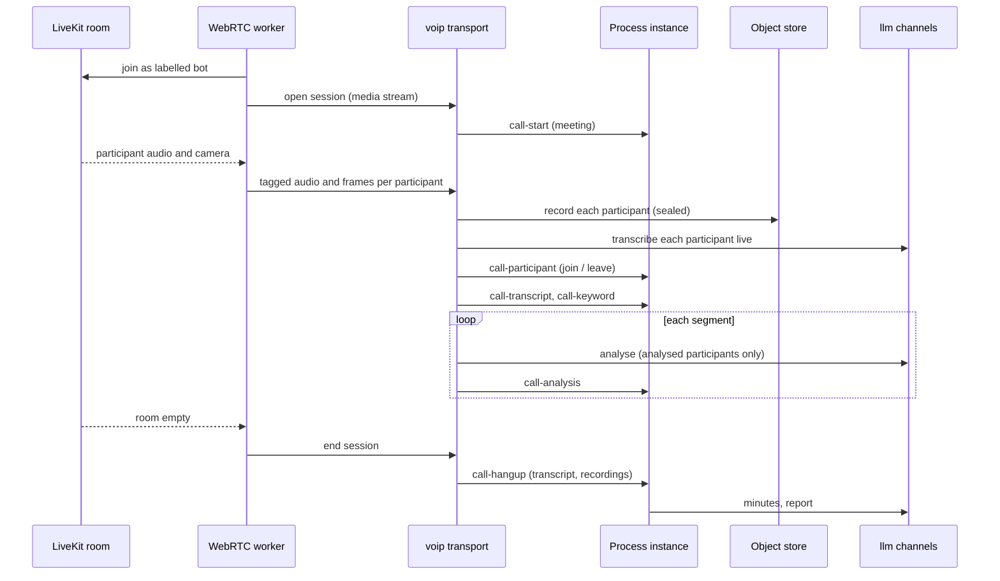

# Meetings and the WebRTC worker

## Two ways into a meeting

- **A conference dial-in.** The flow originates a call to the conference number, sends the meeting
  PIN as DTMF, announces recording, and from then on listens (a *listen-only* call). The meeting
  arrives as one mixed stream from the PBX.
- **A video meeting.** The WebRTC worker joins a LiveKit room as a participant and streams each
  participant separately, audio and sampled frames, over one tagged socket per meeting.

## The meeting session flow

Only the sparse events reach the flow, not raw audio: a participant joining, a phrase being heard,
a segment's analysis, the end of the meeting. After the end, the flow reads the transcript back,
asks a model for the minutes and stores or sends the report.

## Who is analysed

The role of each participant is declared by whoever issues the room token, never inferred. A
participant who is not analysed never reaches the model. See
[Emotion analytics and compliance](../guides/emotion-analytics.md).
