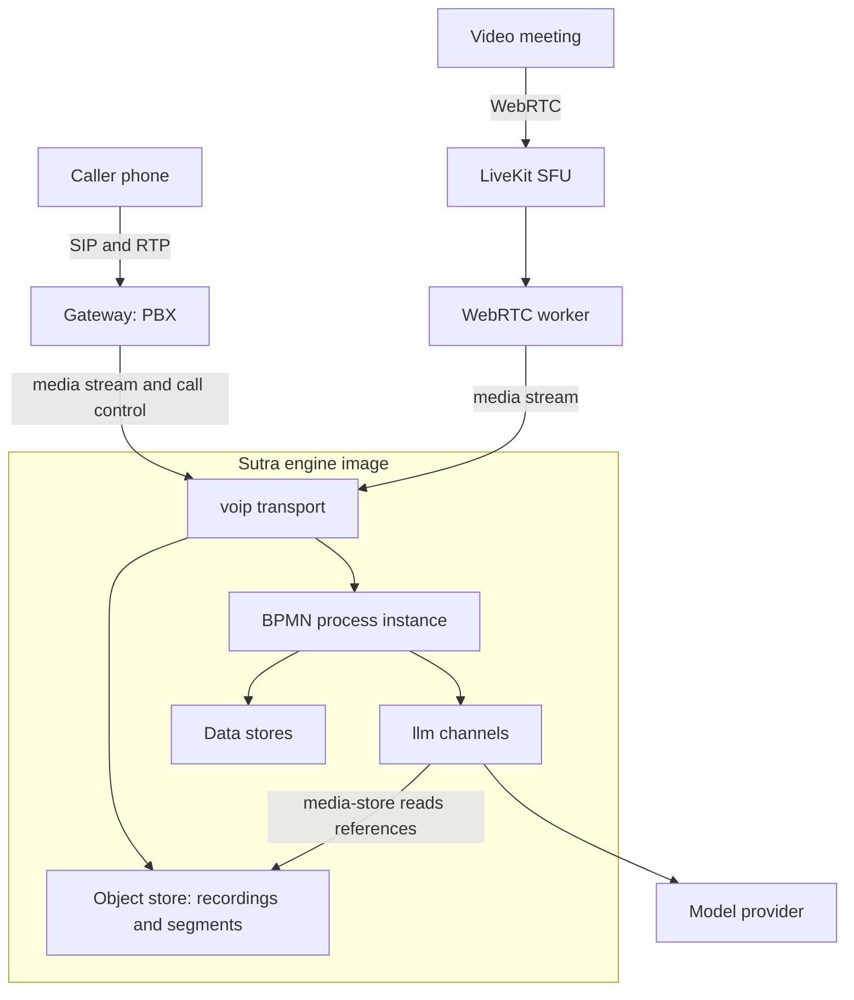

# Overview

## The boundary: engine and voice pack

There is exactly one BPMN implementation, and it is the engine's. Nodes, gateways, events, wait
states, channels, `llm` channels and the `q:` namespace are all engine features, documented in the
[Sutra book](https://sutra.startr.trade/). Sutra Voice consumes the engine as a git submodule and
adds only what the engine's extension points allow:

| Part | What it is |
|---|---|
| `sutra-transport-voip` | The `voip` transport, registered through the engine's transport SPI: a media WebSocket on the engine's HTTP listener, turn detection, paced playback, number binding, listen-only calls, recordings, meeting sessions cut into media segments, audit events, and the rustpbx call-control client. It analyses nothing: what a meeting's media mean is the flow's. |
| `sutra-voice-dist` | The composition root: the engine's default bundle plus `voip`, producing the `sutra-voice-engine` binary and image. |
| `tools/sutra-webrtc-worker` | A separate program, in its own workspace and image, that joins a LiveKit room and streams every participant to the engine. Nothing else links libwebrtc. |
| `examples/` | Four runnable packages and the stub model server. |

The generic seams the pack relies on stay in the engine: `llm` channels with audio input and
media references, the `llm` channel registry, `q:audit capture="media"`, the object store (with
multipart uploads, ranged reads and listings), the transport audit journal, capacity pools and
`session-end`.

## Components

## The media-stream protocol

The transport serves two WebSocket endpoints on the engine's own HTTP listener, with no extra
port: `/voip/bridge`, the PCM bridge a PBX dials, and `/voip/stream`, the gateway-neutral
media-stream protocol. The protocol carries linear PCM (or G.711) frames in both directions plus
small control frames, and one socket can carry a whole meeting: every participant's own audio and
sampled camera frames, tagged by participant. Any gateway that speaks it can drive the engine;
the WebRTC worker is one such gateway.

## Gateways

A gateway terminates SIP and RTP, negotiates codecs, transcodes at the edge and exchanges PCM or
G.711 with the engine. G.729, G.722 or Opus never enter Sutra.

- **rustpbx** is supported today (checked against 0.5.1). Inbound calls reach the engine through
  its IVR app in step mode; the transport takes control of the call over rustpbx's RWI socket to
  originate, transfer and hang up.
- **Generic**: the media stream is the whole interface. Call control (originate, transfer) is
  what a gateway-specific adapter such as the rustpbx one adds.
- **Asterisk and FreeSWITCH** adapters are planned, see the [Roadmap](../roadmap.md).

## The WebRTC worker

For a LiveKit room the worker joins as a visibly labelled bot, subscribes to each participant's
audio and (when requested) camera, and relays them to the engine over the media-stream protocol,
one session per meeting. See [Meetings and the WebRTC worker](meetings.md).

## Recording and the object store

A call or meeting that is recorded streams to an S3-compatible object store through the engine's
object store (multipart uploads of sealed one-second chunks, recoverable after a crash), capped by
a maximum duration, and **referenced by hash** from the audit trail (`q:audit capture="media"`),
never embedded in it. A meeting's segments are written to the same store, sealed, for the flow to
hand to a model by reference. See [Recording and consent](../guides/recording-and-consent.md).

## Analysis lives in flows

The transport handles media and computes generic, domain-free measurements (turn and call
features, acoustic features of a segment). Anything that interprets them, such as an emotion or
engagement analysis, who may be analysed, the prompt and the fusion of the signals, is in the
package's BPMN, DMN and FEEL, versioned with the flow and audited like any other step. See
[Meetings and the WebRTC worker](meetings.md).

## Every model call is a named channel

The transport has no model settings of its own: a voip channel that names a provider, model or key
is refused at load. A responder turn, a live transcription and a segment or post-call analysis are
all `llm` channels declared in the package, with the engine's secret references, retries,
redaction and audit. The transport calls one of them itself (the live transcription session); the
flows call the rest. Swapping a provider,
or the stub used by the tests, is a channel change and not a code change.

## Capacity

A trunk's concurrent-call limit is an engine capacity pool, shared by inbound and outbound calls,
and a call holds one slot until its hang-up. See [Session end and capacity pools](../concepts/pools-and-session-end.md).
